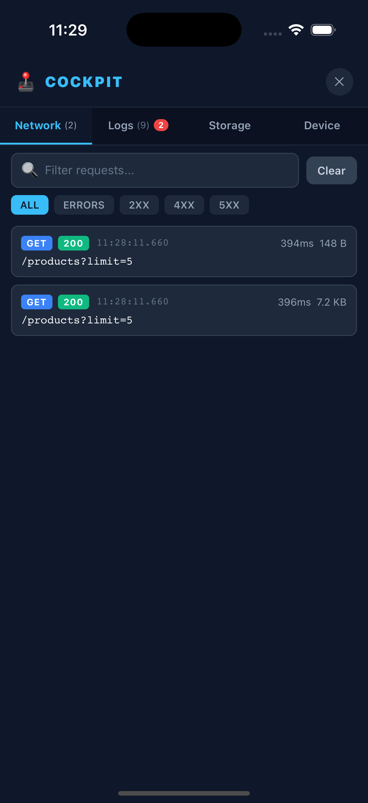
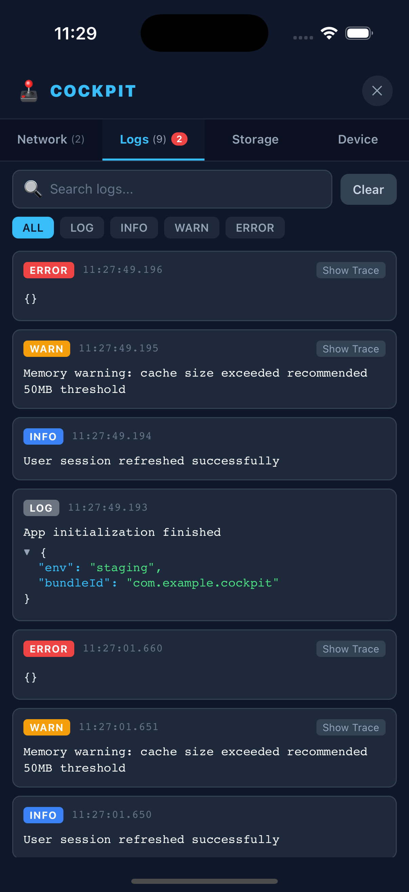
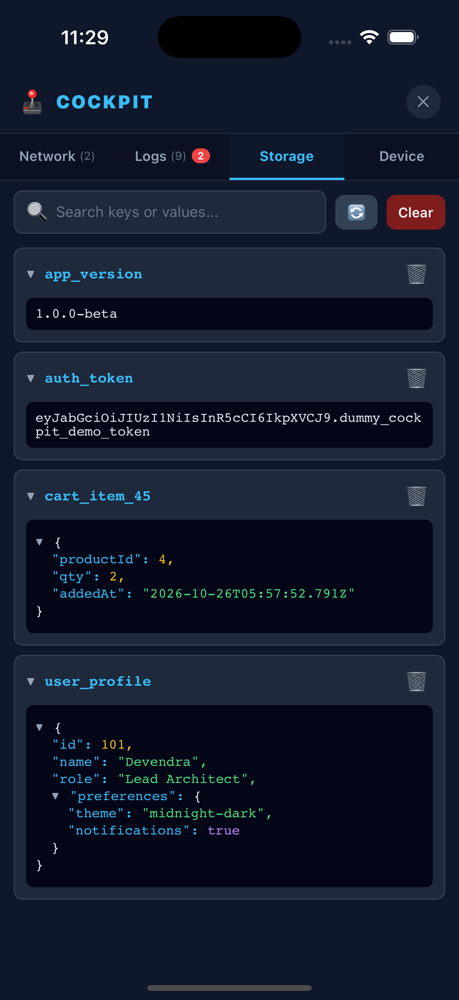
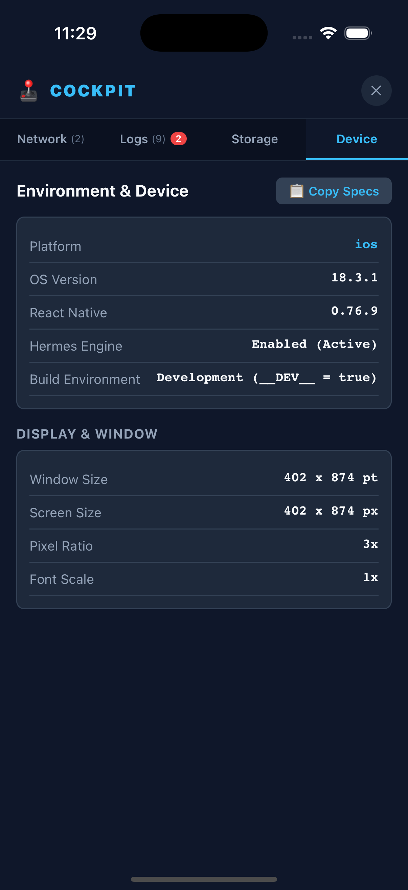
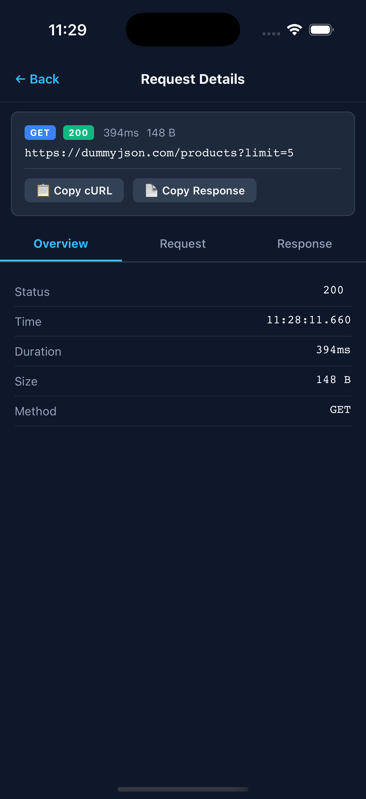
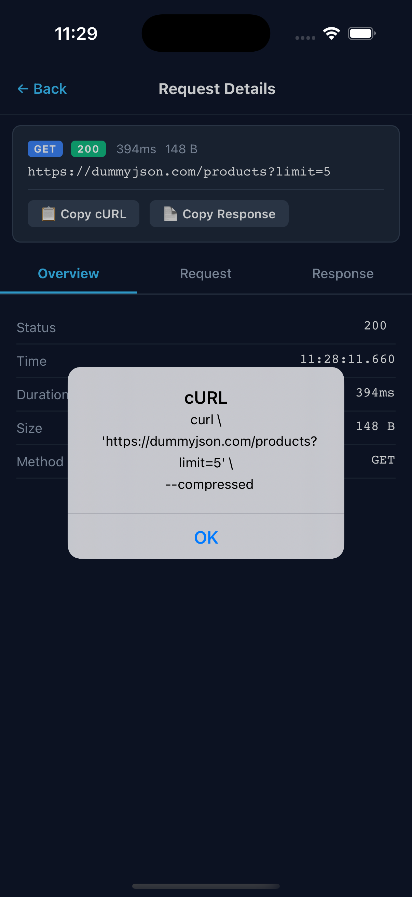
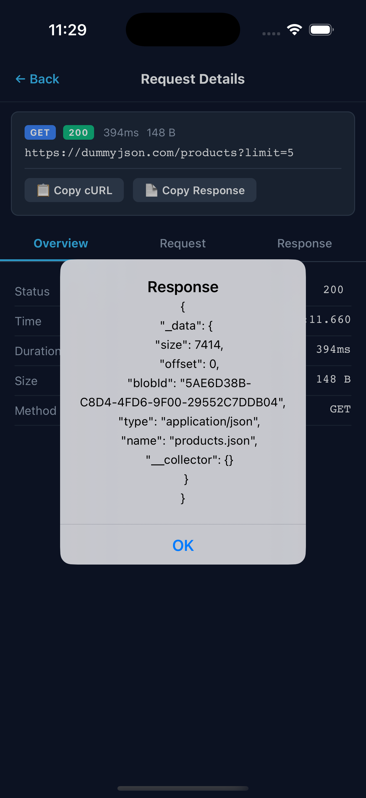

# 🕹️ react-native-cockpit

> **In-App Heads-Up Developer Cockpit for React Native & Expo.**  
> Inspect Network requests, Console logs, AsyncStorage / MMKV, and Device metadata directly on your test device—zero native configuration required.

[](https://www.npmjs.com/package/react-native-cockpit)
[](LICENSE)
[](CONTRIBUTING.md)

---

## ✨ Features

- 🌐 **Network Inspector**: Intercepts `fetch` and `XMLHttpRequest`. Inspect method, status codes, latency, response sizes, request/response headers, and payloads.
- 📋 **Copy as cURL**: Generate ready-to-run cURL commands for any captured request with a single tap.
- 📜 **Console Log Stream**: Live view of `console.log`, `info`, `warn`, and `error` with stack trace inspection and interactive JSON tree rendering without silencing Metro terminal logs.
- 💾 **Storage Browser**: Inspect, search, delete, and clear keys in `@react-native-async-storage/async-storage`, `react-native-mmkv`, or any custom key-value store.
- 📱 **Device & Environment**: Quick specs for React Native version, Hermes engine status, platform, viewport sizes, and pixel ratios.
- 🕹️ **Floating Draggable HUD**: Draggable bubble with real-time error badge counters and edge-snapping physics.
- ⚡ **Zero Native Linking**: Built on pure TypeScript and React Native primitives—works identically in **Expo Go**, Expo Prebuild, and bare React Native.

---

## 📸 Screenshots

| Network Monitor | Console Stream | Storage Inspector | Device Specs |
|:---:|:---:|:---:|:---:|
|  |  |  |  |

| Request Overview | Copy cURL | Response Preview |
|:---:|:---:|:---:|
|  |  |  |

---

## 📦 Installation

```bash
# npm
npm install react-native-cockpit

# yarn
yarn add react-native-cockpit

# bun
bun add react-native-cockpit
```

---

## 🚀 Quick Start

Add `<Cockpit />` at the root of your application (typically in `App.tsx` or `index.js`):

```tsx
import React from 'react';
import { View, Text } from 'react-native';
import { Cockpit } from 'react-native-cockpit';

export default function App() {
  return (
    <View style={{ flex: 1 }}>
      <YourAppNavigator />

      {/* Renders a draggable HUD bubble in __DEV__ */}
      <Cockpit enabled={__DEV__} />
    </View>
  );
}
```

That's it! Tap the floating 🕹️ bubble on your screen to open the Cockpit inspector.

---

## 💾 Storage Integration

### 1. AsyncStorage Integration
```tsx
import AsyncStorage from '@react-native-async-storage/async-storage';
import { Cockpit, StorageManager } from 'react-native-cockpit';

const asyncStorageAdapter = StorageManager.createAsyncStorageAdapter(AsyncStorage);

export default function App() {
  return (
    <View style={{ flex: 1 }}>
      <YourApp />
      <Cockpit storageAdapters={[asyncStorageAdapter]} />
    </View>
  );
}
```

### 2. MMKV Integration
```tsx
import { MMKV } from 'react-native-mmkv';
import { Cockpit, StorageManager } from 'react-native-cockpit';

const storage = new MMKV();
const mmkvAdapter = StorageManager.createMMKVAdapter(storage, 'MMKV Storage');

export default function App() {
  return (
    <View style={{ flex: 1 }}>
      <YourApp />
      <Cockpit storageAdapters={[mmkvAdapter]} />
    </View>
  );
}
```

### 3. Custom Storage Adapter
```tsx
const customAdapter = {
  name: 'UserPreferences',
  getAllKeys: () => ['theme', 'authToken', 'locale'],
  getItem: (key: string) => myCustomStorage.get(key),
  setItem: (key: string, value: string) => myCustomStorage.set(key, value),
  removeItem: (key: string) => myCustomStorage.remove(key),
  clear: () => myCustomStorage.reset(),
};

<Cockpit storageAdapters={[customAdapter]} />
```

---

## ⚙️ Props & Configuration

| Prop | Type | Default | Description |
| :--- | :--- | :--- | :--- |
| `enabled` | `boolean` | `__DEV__` | Whether Cockpit is active. Set to `false` in production. |
| `maxNetworkRequests` | `number` | `100` | Maximum network requests retained in memory buffer. |
| `maxLogs` | `number` | `200` | Maximum console log entries retained in memory buffer. |
| `storageAdapters` | `StorageAdapter[]` | `[]` | Array of storage adapters (AsyncStorage, MMKV, etc.). |
| `bubbleInitialPosition` | `{ x: number, y: number }` | Bottom Right | Initial coordinates for the floating HUD bubble. |
| `onCopyText` | `(text: string) => void` | Optional | Custom clipboard copy handler (e.g. `Clipboard.setString`). |

---

## 🛠️ Programmatic Access

You can also interact with Cockpit programmatically:

```tsx
import { cockpitStore, generateCurl } from 'react-native-cockpit';

// Open Cockpit modal manually (e.g. from a custom secret gesture or Shake event)
cockpitStore.setModalVisible(true);

// Clear logs programmatically
cockpitStore.clearLogs();

// Clear network requests
cockpitStore.clearRequests();
```

---

## 📄 License

MIT © Devendra
